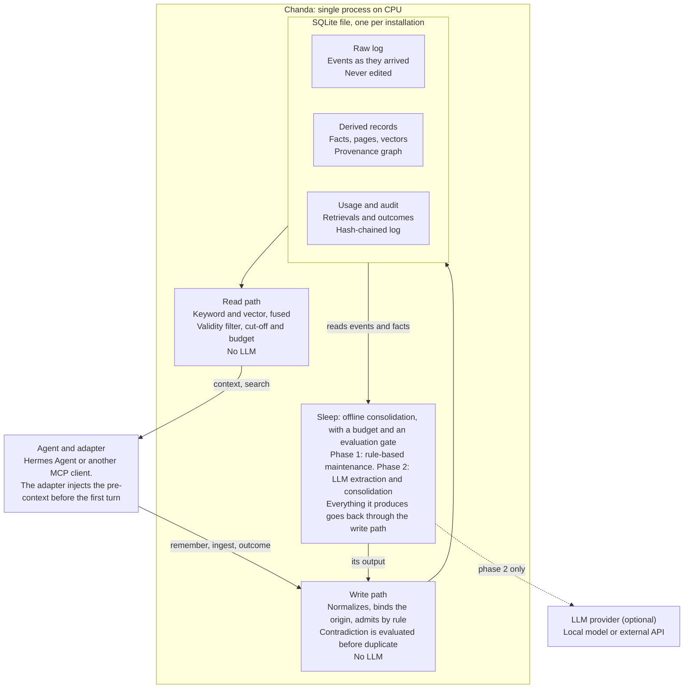

# Chanda MCP: base specification

As of 2026-11-13

Chanda is an MCP memory server for agents, written in Go, that runs locally on CPU: reads and writes are deterministic, and an LLM only takes part in offline consolidation. This document is the base for a coding agent to implement the project.

## Scope

Chanda stores what an agent learns and what the company documents, and returns the right excerpt at the right moment. It does not depend on a specific agent or model: any MCP client can use it.

What it does:

- Ingests documents and agent sessions into a raw log that is never edited.
- Keeps facts with a validity period and explicit supersession of the old fact by the new one.
- Filters, deduplicates and records the origin of everything written, without an LLM.
- Searches by keyword and by vector, reranks and cuts by relevance, without an LLM.
- Delivers a short pre-context to the agent before the first turn.
- Consolidates memory offline, with a defined budget.
- Adjusts ranking locally from task outcomes.
- Deletes in cascade, with proof that nothing derived is left.

What is out of scope for version 1:

- Being the agent. Chanda does not plan or execute tasks.
- Training or fine-tuning LLMs. The only learning is the ranking, local and small.
- Querying the customer's transactional databases. Generating SQL stays with the agent.
- Multi-tenant cloud service. Version 1 isolates by namespace in a single process.
- Depending on the network. No external call is required to read or write.

### Differentiators

Open-source projects already cover local search, temporal validity and deduplication. Chanda is justified by these four points, and each has a test that proves it.

| Differentiator | Why it matters | How it is proven |
| --- | --- | --- |
| Verifiable forgetting | None of six tested systems passed more than 1.5% of forget requests | Deletion suite: after `forget`, no search, fact, vector or summary returns the content |
| Origin bound at write time | Binding origin at write time brought poisoning attacks to zero in one study; prompt filters barely helped | Injection suite: content from an untrusted zone never becomes an instruction or a trusted fact |
| Reproducible evaluation | Rankings in the field change when only the embedding model is swapped | Report against plain RAG at an equal budget, with the embedding declared and cost per query |
| Company corpus, not only conversation | Documents change, and facts derived from old versions must fall with them | Update suite: changing a document invalidates the facts derived from the changed chunk |

## Inviolable principles

These rules apply to all code. A change that breaks any of them must be rejected, even if it improves a metric.

1. **The raw log is the source of truth.** Events and documents are stored as they arrived and are never edited. All derived memory must be rebuildable from it.
2. **No LLM on the read path.** A query uses only indexes, rules and small models on CPU. *Exception, decision 0151: with an LLM configured, agentic search (on by default, `read.agentic_search`) asks it for search terms before the read. Without `llm.endpoint` the rule holds as written.*
3. **No LLM on the synchronous write path.** Writing costs a hash, an embedding and rules. LLM extraction only happens during sleep.
4. **Every derived record points to its origin.** Facts, vectors, summaries and consolidated pages carry pointers to the events that produced them.
5. **Origin is fixed at write time and never rises on its own.** The trust zone of a derived record is the lowest among those of its origins.
6. **Nothing is erased by supersession.** A new fact closes the validity of the previous one. Physical deletion only happens through `forget`.
7. **Contradiction is evaluated before duplication.** A record similar to another, but with a different value, is an update, not a copy.
8. **With no relevant result, the return is empty.** The pre-context is never filled with the "least bad" item.
9. **Learning never degrades the baseline undetected.** Learned ranking only goes live after passing the fixed evaluation, and can be turned off with one option.
10. **Every mutation is an auditable event.** Writes, supersessions, consolidation, ranking adjustments and deletions go to an audit log with date and author.
11. **Same input, same output.** Reads and writes are deterministic given the same database state and the same configuration.

## Architecture



The agent writes and reads through two paths without an LLM, which share a single SQLite file. Sleep is the only point where an LLM takes part, and what it produces returns through the write path, subject to the same rules.

## Data model

Everything lives in a single SQLite file per installation, isolated by `namespace` in every table. There are three layers: the raw log, the derived records, and the learning and audit state.

| Table | Layer | Holds | Main fields |
| --- | --- | --- | --- |
| `sources` | Raw | Where the content came from | `id`, `namespace`, `kind` (document, session, tool, web, user statement), `uri`, `trust_zone` |
| `documents` | Raw | Each ingested document and its current version | `id`, `source_id`, `uri`, `current_version`, `updated_at` |
| `events` | Raw | Each document chunk or session turn, as it arrived | `id` (ULID), `source_id`, `kind`, `content`, `content_hash` (SHA-256), `trust_zone`, `actor`, `recorded_at`, `doc_id`, `doc_version`, `ordinal`, `retired_at` |
| `entities`, `entity_aliases` | Derived | Canonical entities and their normalized aliases | `id`, `canonical_name`, `type`; `alias_norm`, `entity_id` |
| `predicates` | Derived | Catalog of attributes and their cardinality | `name`, `cardinality` (`single` or `multi`) |
| `facts` | Derived | Facts with two time axes | `id`, `subject`, `predicate`, `value`, `value_norm`, `valid_from`, `valid_to`, `recorded_at`, `superseded_by`, `status`, `confidence`, `trust_zone`, `text` |
| `pages` | Derived | Consolidated memory: summaries, lessons and procedures | `id`, `kind`, `title`, `body`, `version`, `sleep_run_id`, `status`, `trust_zone` |
| `embeddings` | Derived | One vector per record and per model | `record_type`, `record_id`, `model_id`, `dim`, `vector` |
| FTS5 indexes | Derived | Full-text search over `events`, `facts` and `pages` | one virtual table per record type |
| `provenance` | Derived | Edges of the provenance graph | `derived_type`, `derived_id`, `source_type`, `source_id`, `relation` |
| `retrievals` | Learning | Each query, its candidates and what was delivered | `id`, `session_id`, `query_text`, `candidates` (ids, scores, features), `delivered`, `ts` |
| `outcomes` | Learning | The outcome linked to a query | `retrieval_id`, `signal`, `value`, `used_ids`, `ts` |
| `utility` | Learning | Utility statistics per record | `record_type`, `record_id`, `n_shown`, `n_used`, `n_success`, `score` |
| `sleep_runs` | Audit | Each sleep run | `id`, `started_at`, `ended_at`, `budget`, `inputs`, `outputs`, `snapshot`, `status` |
| `audit_log` | Audit | Every mutation, in a hash chain | `id`, `ts`, `actor`, `action`, `target`, `details`, `prev_hash`, `hash` |
| `tombstones` | Audit | Proof of each deletion | `id`, `ts`, `scope`, `requested_by`, `removed_counts` |

### The two time axes

Each fact has the period in which it was true in the world (`valid_from`, `valid_to`) and the moment the system learned of it (`recorded_at`). A null `valid_to` means current. This makes it possible to answer "what holds today" and "what did we know in March".

### Integrity rules

- `events.content` and `events.content_hash` do not accept `UPDATE`. A database trigger rejects the operation. Only `retired_at` may change.
- For `single` predicates, there is at most one fact with `status = active` per (`namespace`, `subject`, `predicate`). A partial unique index enforces this.
- Every fact, page and vector has at least one path in `provenance` to an `event`. A checker runs at the end of every write and every sleep.
- The `trust_zone` of a derived record is the lowest zone among its origins. Zones, from lowest to highest: `external`, `internal`, `user`.
- `embeddings` is keyed by `model_id`. Changing the embedding model creates new vectors without deleting the old ones until the migration finishes.
- An unknown predicate enters as `multi`. Only predicates declared `single` trigger automatic supersession.

## Write path

Every write goes through the same steps, in the same order, without an LLM. The order matters: contradiction is evaluated before duplication.

1. **Normalize.** Unicode NFC, collapsed whitespace, standardized line breaks. SHA-256 is computed over the normalized text.
2. **Bind the origin.** The trust zone comes from the input channel, never from the content. A direct user statement is `user`; a configured folder or session is `internal`; tool results and the web are `external`.
3. **Admit.** Rules reject content that is empty, too short or over the size limit. Secrets (keys, tokens) are masked by regular expression. Text from the `external` zone that is shaped like an instruction receives the `instruction_like` mark.
4. **Check for exact duplicates.** If the hash already exists for the same source, no new event is created. The response returns the existing id.
5. **Write the raw event.** The write only returns once the event is durable on disk.
6. **Compare document versions.** The document is split by structure (headings and paragraphs, no overlap). Chunks whose hash equals the previous version are kept. Chunks that disappeared receive `retired_at`, and the facts derived from them become `stale_source`.
7. **Index.** The text goes into FTS5 and into the embedding queue. The queue runs on CPU and may lag; the `flush` tool waits for the index to catch up with writes.
8. **Resolve entities.** The alias is normalized (lowercase, no accents, no punctuation) and looked up in `entity_aliases`. Without an exact match, a new entity is created. Similarity-based merging is left to sleep.
9. **Reconcile facts.** The decision table below applies.
10. **Mark near-duplicates.** Only after step 9. The record is not deleted: it receives a `duplicate_of` edge and is collapsed at read time.
11. **Audit and respond.** The response reports the id, the action taken and the reason.

### Where facts come from on the synchronous path

Facts are only created without an LLM in two ways: the `assert_fact` tool, where the agent already supplies subject, attribute and value, and configurable deterministic extractors (metadata headers, key-value tables, regular-expression patterns). Extracting facts from free text is the job of sleep.

### Decision table for facts

| Situation of the new fact against the active fact with the same subject and attribute | Action |
| --- | --- |
| Same normalized value | Does not create a fact. Adds a provenance edge to the existing fact and raises `confidence` |
| Different value, `single` attribute, later date | Closes the old one (`valid_to` = the new one's `valid_from`, `status = superseded`) and inserts the new one |
| Different value, `single` attribute, date earlier than the active fact | Inserts the new one already closed, as history. The active fact does not change |
| Different value, `multi` attribute | Both coexist |
| New fact from a lower zone than the active fact | Goes to `quarantined`. It supersedes nothing until reviewed |

`valid_from` uses, in this order: the date given in the call, the document date, `recorded_at`.

### Near-duplicate guard

Two records are near-duplicates only if cosine similarity exceeds the threshold (default 0.95) and if numbers, dates, entities and negation markers are identical after normalization. "The price is 10" and "the price is 12" are similar and are not duplicates.

## Read path and pre-context

A query goes through indexes, rules and, optionally, a small reranker on CPU. There are two modes: `search`, the free read that returns a ranked list, and `context`, which returns a short, already filtered pre-context.

1. **Receive the query.** Text, `namespace`, optional filters (record type, zone, reference date `as_of`) and a token budget.
2. **Search by keyword.** FTS5 with BM25, top 50 per record type.
3. **Search by vector.** The query embedding is computed on CPU; 50 nearest neighbours.
4. **Filter by rule.** Only `active` facts valid at `as_of`, events without `retired_at` and records outside `quarantined` remain. Near-duplicates are collapsed into the most recent record.
5. **Fuse.** Reciprocal Rank Fusion (k = 60) over the two lists.
6. **Rerank.** A small cross-encoder scores the top 30. The step is optional by configuration.
7. **Adjust by utility.** Final score = (1 − λ) × relevance + λ × utility. λ starts at 0 and only rises through the process in the ranking section.
8. **Cut.** Items below the relevance threshold are dropped. If nothing is left, the return is empty, with the reason `no_relevant_memory`.
9. **Diversify and respect the budget.** At most three items per source document. The list is filled up to the token budget.
10. **Assemble the response.** Each item carries id, type, text, validity, origin and zone.
11. **Log.** Candidates, scores, features and delivered items go to `retrievals`.

### Differences between the modes

| Aspect | `search` | `context` |
| --- | --- | --- |
| Threshold cut (step 8) | No; only the item limit | Yes |
| Default budget | 20 items | 800 tokens, ceiling of 1,500 |
| Output order | By score | Current facts, then consolidated pages, then raw excerpts |
| `instruction_like` content | Returned, with the mark | Never included |
| Items from the `external` zone | Returned, with the zone | Included as a labelled quotation, never as guidance |
| History and superseded facts | On request (`include_history`) | Never |

### Time queries

`as_of` answers "what held on that date". The `timeline` tool returns the full chain for a subject and attribute, from the oldest fact to the current one, with the origins of each change.

### Performance targets

These are design targets, to be confirmed by measurement: with 100 thousand records and four cores, p95 under 150 ms without the reranker and under 600 ms with the reranker.

## Sleep

Sleep is the only place where an LLM touches memory, and everything it produces goes through the same deterministic write path. It runs in two phases: the first always, the second only if an LLM provider is configured.

### When it runs

On idleness (default: 30 minutes without a write) combined with volume (default: 200 new events) or interval (default: 24 hours). It also runs on demand through the `sleep_run` tool. A run never starts during a write burst.

### Phase 1: deterministic maintenance

- Checks integrity: every derived record reaches an event through the provenance graph.
- Finishes pending embeddings and compacts the indexes.
- Recomputes `utility` from `retrievals` and `outcomes`.
- Proposes entity merges by name and vector similarity. The proposal stays pending; it is not applied on its own.
- Marks as `stale_source` the facts whose origin was retired.
- Takes a snapshot of the database before any phase 2 change.

### Phase 2: LLM consolidation

1. **Extract facts** from raw events not yet processed. Each candidate enters through steps 8 to 10 of the write path, with an edge to its source event.
2. **Judge pending items.** Facts in `quarantined` and proposed entity merges receive a verdict restricted to a closed set: supersede, coexist, reject, keep pending.
3. **Update pages.** Lessons arise from repeated patterns (default: three or more similar events). Pages are changed by adding items, never rewritten whole.

### Safeguards

- **Budget.** A ceiling on tokens and events per run. On reaching the ceiling, the run stops and continues in the next one.
- **Validated output.** The LLM answers in JSON with a fixed schema. An invalid answer is discarded, with no automatic retry.
- **Staging area.** Phase 2 changes stay staged until they pass the gate.
- **Evaluation gate.** The fixed question set runs before and after. A drop above the tolerance (default: 2 points) discards the staged changes and restores the snapshot.
- **A page cites events.** A page cannot have only other pages as its origin. Each item points to raw events.
- **Inherited zone.** A page's zone is the lowest among its origins. Consolidation does not promote external content.
- **Idempotence.** Each event stores the run that processed it. Running again duplicates nothing.
- **Report.** Each run writes a readable report: what was created, superseded, merged and rejected, and the cost.

The LLM provider is an interface: a local model through an endpoint compatible with the OpenAI API, or an external API. Without a provider, Chanda works in full, only without free-text extraction and without pages.

## Ranking that learns from use

Chanda learns, per namespace and only on the local machine, which records actually help with tasks. The repository does not ship trained ranking weights: each installation starts from zero and falls back to standard search until it has enough signal.

### Signals

| Signal | How it arrives | Weight |
| --- | --- | --- |
| Task outcome | `outcome` tool, with a value from −1 to 1 and the retrieval id | Main |
| Records actually used | `used_ids` field of `outcome` | Defines who gets the credit |
| Delivered and not used | Derived from `retrievals` minus `used_ids` | Weak negative |
| Marked as wrong or outdated | `flag` tool | Strong negative; removes the record from reads |

### Stage 1: utility per record

Each record keeps a Beta distribution of utility. Used with success adds 1 to the positive side; used with failure adds 1 to the negative side; delivered and not used adds 0.25 to the negative side. The outcome is centred on the namespace's moving average before it counts, so that easy tasks do not inflate irrelevant records. Utility only enters the score after five exposures.

### Stage 2: small ranker

A logistic regression or an MLP with one hidden layer, trained on CPU over `retrievals`. The target is "was used and the task succeeded". Input features:

- BM25 score, cosine similarity and reranker score;
- age of the record and time since last use;
- record type and trust zone;
- mean and count of utility;
- entity match between query and record.

The trained model is versioned in the database, with the date, the number of examples and the evaluation score.

### Safeguards

- **Shadow mode first.** The learned score is computed and logged, but does not change the order, until it is promoted.
- **Promotion by evaluation.** λ only leaves 0 if the learned ranking beats the baseline on the fixed question set, by a configured margin.
- **The cut stays relevance-based.** Utility reorders what passed the threshold; it never admits an item that did not.
- **No randomness.** There is no stochastic exploration by default, to preserve determinism.
- **Signals from the external zone are ignored.** Only the agent or the user of the session can send `outcome`, with a rate limit.
- **Reversibility.** A configuration option turns learning off; `ranking_reset` clears the state. Both actions go to the audit log.

A known limitation: only delivered items receive a signal, so what never appears is never evaluated. The minimum exposure threshold and the ceiling on λ (default 0.3) reduce the effect, but do not eliminate it.

## Provenance, forgetting and security

The provenance graph underpins all three: knowing where each record came from, deleting everything derived from something, and preventing untrusted content from gaining authority.

### Trust zones

| Zone | Enters through | Becomes an active fact | In the pre-context | Supersedes a fact from a higher zone |
| --- | --- | --- | --- | --- |
| `user` | Direct user statement | Yes | Yes | Not applicable |
| `internal` | Configured documents and sessions | Yes | Yes | No |
| `external` | Tool result, web, email | Yes, with the zone marked | Only as a labelled quotation | No; goes to `quarantined` |

Rules:

- The zone is defined by the input channel and stored with the event. No text can declare its own zone.
- The zone of a derived record is the lowest among its origins, including after sleep.
- Only the `promote` tool, called by a human actor, raises a record's zone. The action is audited.
- The pre-context is delivered in a delimited block that states: retrieved information, not instructions.
- The `namespace` filter is applied in the query and again after the search, before the response.
- The audit log is a hash chain. The `verify` tool checks the chain and the integrity of the graph.

### Forgetting

`forget` accepts five scopes: record id, document or source, entity, date range and search match. The `dry_run` parameter returns what would be removed, without removing it.

1. **Resolve the scope** into the set of root events.
2. **Walk the provenance graph** from them and collect every derived record: facts, pages, vectors, FTS entries, `utility` rows, and `retrievals` and `outcomes` records that cite the content.
3. **Handle derived records with other origins.** A fact with another origin survives and loses only the edge. A page with any forgotten origin leaves reads immediately and is rebuilt in the next sleep, without the removed content.
4. **Delete physically.** Remove the rows, the vectors and the FTS entries; then overwrite the database's free pages and truncate the write-ahead log (WAL) file.
5. **Handle snapshots.** Earlier snapshots that contain the content are deleted.
6. **Write the tombstone.** `tombstones` records scope, author, date and counts. Neither the tombstone nor the audit log stores the content.
7. **Verify.** Automatic probes confirm the absence: full-text search for distinctive terms, vector search with the vector saved before deletion, and a scan of the file's bytes.
8. **Respond** with the verification report.

`forget` is the only operation that deletes content from the raw log. Supersession, `flag` and consolidation never delete.

## MCP interface and agent integration

Chanda exposes 20 MCP tools, over stdio and HTTP, grouped into three profiles. The profile is chosen in the configuration: an agent that reads untrusted content should not receive the administration profile.

| Tool | Profile | What it does | Main inputs |
| --- | --- | --- | --- |
| `context` | Read | Short, filtered pre-context | `query`, `budget_tokens`, `as_of` |
| `search` | Read | Ranked list, free read | `query`, `filters`, `limit`, `include_history` |
| `get` | Read | One record by id, with its origins | `id`, `expand_neighbors` |
| `timeline` | Read | History of a subject and attribute | `subject`, `predicate` |
| `explain` | Read | Scores at each stage for a query and a record | `retrieval_id`, `record_id` |
| `stats` | Read | Counts, size, last sleep, ranking state | none |
| `remember` | Standard | Writes free text | `content`, `source`, `valid_from` |
| `assert_fact` | Standard | Writes a structured fact | `subject`, `predicate`, `value`, `valid_from` |
| `ingest` | Standard | Ingests a document or a folder | `path`, `source` |
| `log_session` | Standard | Writes the turns of a session | `session_id`, `turns` |
| `outcome` | Standard | Reports the outcome of a task | `retrieval_id`, `value`, `used_ids` |
| `flag` | Standard | Marks a record as wrong or outdated | `id`, `reason` |
| `flush` | Standard | Waits for the index to catch up with writes | none |
| `forget` | Administration | Deletes in cascade and verifies | `scope`, `dry_run` |
| `promote` | Administration | Raises a record's zone | `id`, `zone` |
| `sleep_run` | Administration | Triggers sleep | `phases`, `budget` |
| `verify` | Administration | Checks the audit log and the provenance graph | none |
| `ranking_reset` | Administration | Clears the learning state | none |
| `learned_keys` | Administration | Learned query keys: enable, disable, reset, rebuild, stats (decision 0145) | `action` |
| `conflicts` | Administration | Conflict resolution between raw records: list, revert, reset, scan, stats (decision 0148) | `action`, `id`, `write`, `details`, `min_cosine` |

Every tool receives `namespace` and answers in the same envelope: `ok`, `data`, `notices` and `audit_id`. Errors use stable, documented codes.

Besides MCP, the same core is exposed through a command line (`chanda serve`, `ingest`, `sleep`, `eval`, `forget`) and through an importable Go package.

### Why MCP alone is not enough

Agents rarely ask for memory on their own. In one study, an agent with its memory already filled made zero calls in 114 turns. Delivery has to start from the environment that runs the agent, at three moments:

1. **Before the first turn.** The adapter calls `context` with the user's request and injects the result into the initial context.
2. **During the task.** The agent uses `search`, `get` and `timeline` whenever it wants.
3. **On finishing.** The adapter calls `log_session` and `outcome`.

The repository ships a reference adapter for Hermes Agent and a generic example for other agents. The Hermes extension interface must be checked in the current version before implementing; this document does not specify it.

## Go stack and repository structure

Chanda is a single binary, compiled without cgo, that stores everything in one SQLite file. Each external dependency sits behind an interface, so it can be replaced without touching the core.

| Component | Choice | Reason | To be confirmed by the coding agent |
| --- | --- | --- | --- |
| MCP protocol | [Official Go SDK](https://github.com/modelcontextprotocol/go-sdk/releases), v1.7.0 in November 2026 | Maintained alongside the specification; covers stdio and HTTP | Current version and the protocol revision supported by the target clients |
| Database | [`modernc.org/sqlite`](https://github.com/cvilsmeier/go-sqlite-bench) | SQLite in pure Go, no cgo | That FTS5 is enabled in the build used |
| Full-text search | FTS5 with the `unicode61` tokenizer and diacritic removal | Works in Portuguese; the Porter stemmer is English-only | Quality in Portuguese on the evaluation set |
| Vector search | Exact scan in Go over vectors stored as BLOBs | Deterministic and simple; approximate indexes depend on insertion order | Latency with 100 thousand vectors; [a pure-Go implementation](https://github.com/ANetResearch/anet-sqlite-v) measures about 23 ms for 10 thousand 768-dimension vectors |
| Embeddings | [hugot](https://pkg.go.dev/github.com/dpoage/known), ONNX inference in pure Go | Runs on CPU without cgo; already used by other Go memory projects | Support for a small multilingual model; the library's default is English-oriented |
| Reranker | Small cross-encoder, optional | Improves the order of the top 30 | Whether hugot runs cross-encoders; without that, the step stays off |
| Learned ranker | Own implementation in Go | Logistic regression and a small MLP fit in a few hundred lines | Nothing |
| Sleep LLM provider | HTTP client for an endpoint compatible with the OpenAI API | Serves a local model and an external API with the same code | Nothing |

The corpus is assumed to be in Portuguese, so the embedding model needs to be multilingual. The `model_id` of each vector is stored precisely to allow a later swap.

### Core interfaces

| Interface | Responsibility |
| --- | --- |
| `Store` | Transactions, schema, migrations and SQLite queries |
| `Embedder` | Text to vector; reports `model_id` and dimension |
| `VectorIndex` | Insert, remove and search neighbours |
| `Reranker` | Score query-record pairs |
| `LLMProvider` | Sleep calls, with validated JSON output |
| `Clock` | Current time; replaceable in tests to guarantee determinism |

### Repository structure

```
chanda/
  cmd/chanda/          command-line and server entry point
  internal/store/      schema, migrations, queries
  internal/write/      write path, steps 1 to 11
  internal/read/       read path, search and context modes
  internal/facts/      entities, predicates, temporal reconciliation
  internal/prov/       provenance graph, zones, checker
  internal/forget/     cascade deletion and verification probes
  internal/sleep/      phases 1 and 2, evaluation gate
  internal/rank/       utility, ranker, shadow mode
  internal/embed/      Embedder, VectorIndex, Reranker
  internal/llm/        LLMProvider
  internal/mcp/        tool registration and profiles
  internal/audit/      hash-chained log
  pkg/chanda/          public API of the Go package
  eval/                sets, baselines and evaluation reports
  adapters/hermes/     reference adapter
  adapters/generic/    example for other agents
  docs/                this specification and the architecture decisions
```

### Conventions

- Configuration in a `chanda.yaml` file, with every threshold and default cited in this document.
- Schema migrations are numbered and forward-only.
- Every package has tests; `write`, `read`, `facts` and `forget` have table tests for each rule in this specification.
- A determinism test runs the same sequence of operations twice and compares the databases byte for byte, with a fixed `Clock`.
- Each decision that diverges from this specification becomes a short record in `docs/decisions/`.

## Evaluation

Every Chanda result is published against a simple baseline, with the same context budget, the same embedding model and the cost per query. The `chanda eval` command generates the full report, and the scripts live in the repository.

### Configurations compared

Each configuration changes a single variable relative to the previous one.

| Code | Configuration |
| --- | --- |
| B0 | No memory |
| B1 | BM25 over the raw history |
| B2 | Plain RAG: raw chunks, same embedding model |
| B3 | Full context, when it fits in the window |
| C1 | Chanda: hybrid search with fusion, no reranker |
| C2 | C1 plus the reranker |
| C3 | C2 plus facts with temporal validity |
| C4 | C3 plus sleep |
| C5 | C4 plus learned ranking |

### Own suites

They are deterministic and do not use an LLM as judge. Each proves a principle or a differentiator.

| Suite | What it measures | Initial target |
| --- | --- | --- |
| Temporal | Rate of answers with an already superseded value | Up to 1% |
| Deletion | `forget` requests that pass every probe | 100% |
| Injection | `external` content that becomes guidance or a higher-zone fact | 0% |
| Document update | Facts from retired chunks that remain active | 0% |
| Deduplication | Updates discarded as duplicates; real duplicates not collapsed | 0% and up to 5% |
| Abstention | Empty pre-context when the corpus has no answer | 95% precision |
| Learning | Gain of C5 over C4 along a sequence of tasks | Positive, with no regression at the gate |
| Determinism | Identical databases in two equal runs | 100% |

The targets are design hypotheses. The report publishes the measured value, including when the target is not met.

### Public sets

LongMemEval and LoCoMo, as the most widely used, and a larger-scale set such as BEAM. LoCoMo is saturating and has known errors in its answer key, so it serves to compare, not to conclude.

### Metrics

- **Retrieval, without an LLM:** recall@k, MRR and nDCG over the gold chunks.
- **Final answer:** accuracy with a declared reader model and judge, plus a hand-checked sample.
- **Cost:** context tokens per query, p50 and p95 latency for reads and writes, tokens spent in sleep, size on disk.
- **Mandatory reporting:** configuration hash, `model_id` of the embedding and the reader, hardware and Chanda version.

### Comparison with other systems

The compared systems run in the same test environment, with the same reader and the same context budget. Candidates: Mem0 (open-source version), Graphiti, Memor, ferrex and localmem-mcp. The report also shows the cases where Chanda loses.

### Gate set

Each namespace has a fixed set of 50 to 100 questions with an answer key, used by the sleep gate and by ranking promotion. It never enters the ranker's training.

## Build order

There are ten phases, and none starts before the previous one meets its acceptance criterion. The evaluation environment arrives in phase 2, before the features, so that every later phase is measured against the baseline.

| Phase | Deliverable | Acceptance criterion |
| --- | --- | --- |
| 0. Foundation | Repository, configuration, `Store` with migrations, audit log, `Clock`, continuous integration | Migrations apply to an empty database; the audit chain verifies; the determinism test passes |
| 1. Raw log | Write steps 1 to 6: normalization, origin, admission, exact duplicate, events, version comparison | An `UPDATE` on event content is rejected; re-ingesting a changed document retires only the chunks that changed |
| 2. Text reads and minimal MCP | FTS5; `search`, `get`, `remember`, `ingest`, `stats` over stdio; `chanda eval` with B0, B1 | An MCP client lists and calls the tools; the B1 report is generated with one command |
| 3. Hybrid search | `Embedder`, `VectorIndex`, fusion, filters, `flush`; B2 in the evaluation environment | C1 matches or beats B2 on recall@10 at an equal budget; latency measured and recorded |
| 4. Temporal facts | Entities, predicates, `assert_fact`, decision table, `timeline`, `as_of`, near-duplicate guard | Temporal and deduplication suites within target |
| 5. Pre-context and adapters | `context` mode with cut and budget; optional reranker; Hermes adapter and generic example | Abstention suite within target; an end-to-end test shows the pre-context at the start of the session |
| 6. Origin, zones and forgetting | Graph checker, zones, `promote`, `forget` with probes, `verify`, tool profiles | Deletion suite at 100%; injection suite at 0% |
| 7. Sleep | Phase 1; then phase 2 with staging area, snapshot and gate | Running twice duplicates nothing; a planted regression is reverted by the gate; update suite at 0% |
| 8. Learned ranking | `outcome`, `flag`, utility, shadow mode, ranker, promotion, `ranking_reset` | Learning suite positive; turning learning off returns exactly the order of C4 |
| 9. Comparison and release | Report against the other systems, usage documentation, binaries | The report is reproduced from a clean clone with one command |

Each phase ends with the tests passing, the evaluation report updated in the repository and the divergent decisions recorded in `docs/decisions/`.

## Open questions

None of these blocks phases 0 to 2. Each needs an answer before the phase indicated.

- [ ] **Repository licence** (MIT or Apache-2.0). Before phase 0.
- [ ] **Default multilingual embedding model**, and whether it runs on hugot in pure Go. Before phase 3.
- [ ] **Target scale for version 1:** 100 thousand or 1 million records. Above a few hundred thousand, the exact scan stops being enough. Before phase 3.
- [ ] **Initial catalog of `single` predicates** (for example: job title, address, current price, owner). Before phase 4.
- [ ] **Reranker in pure Go.** If there is none, the step stays off in version 1 or cgo is accepted as a build option. Before phase 5.
- [ ] **Hermes extension interface** in the current version: memory provider, plugin or another mechanism. Before phase 5.
- [ ] **Does the tombstone keep a hash of the deleted content?** The hash prevents re-ingestion, but it is a residue of what was forgotten. Before phase 6.
- [ ] **Snapshots and forgetting.** Is deleting old snapshots acceptable, or must they be rewritten without the content? Before phase 6.
- [ ] **Per-user access control within a namespace.** Out of version 1, unless decided otherwise. Before phase 6.
- [ ] **Who writes the gate set in a new installation.** Proposal: sleep suggests questions from the corpus and a person approves them. Before phase 7.
- [ ] **Reliability of `used_ids`.** The agent reports what it used; there is no way to check without reading its answer. Before phase 8.

## References

Each decision in this specification rests on at least one work below. Most identifiers came from a [review of 3,283 papers](https://openchamber.dev/blog/agent-memory-research/) published in October 2026, read in full; the individual papers were not read in full. Check each one at the source before citing it publicly.

| Topic | Reference | Finding used here |
| --- | --- | --- |
| Raw log and search | [MemDelta](https://arxiv.org/abs/2606.29914) | Plain RAG ties with elaborate systems; swapping only the embedding moves the ranking by 6.2 points |
| Raw log and search | [Diagnosing Retrieval vs. Utilization Bottlenecks](https://arxiv.org/abs/2603.02473) | The retrieval method moves accuracy by 20 points; the write strategy, by 3 to 8 |
| Temporal validity | [Temporal Validity in Retrieval Memory](https://arxiv.org/abs/2606.26511) | A deterministic supersession rule brings stale answers close to zero |
| Temporal validity | Zep / Graphiti (Rasmussen et al., 2025) | Knowledge graph with validity periods |
| Write admission | [A-MAC](https://arxiv.org/abs/2603.04549) | Admission by readable factors, with 31% lower latency than LLM-driven decisions |
| Write admission | [Evidence-Gated Memory Writing](https://doi.org/10.1109/ICIPAI70034.2026.11605481) | Writing only above thresholds cuts contamination by 67 to 70% |
| Order between duplicate and contradiction | [Governed Shared Memory](https://arxiv.org/abs/2606.24535) | A near-duplicate gate discarded a contradicting record before it was analysed |
| Contradiction as concurrency control | [TOKI](https://arxiv.org/abs/2606.06240) | The losing fact stays in an audit row |
| Delivery by the environment | [Delivery, Not Storage](https://arxiv.org/abs/2607.20972) | Zero memory calls in 114 turns; deterministic injection fired every time |
| Consolidation | [Useful Memories Become Faulty](https://arxiv.org/abs/2605.12978) | Continuous LLM consolidation ends up below the no-memory baseline |
| Consolidation | [Auto-Dreamer](https://arxiv.org/abs/2605.20616) | A separate offline consolidator gains 7 points with a memory 12 times smaller |
| Consolidation | [Agentic Context Engineering (ACE)](https://arxiv.org/abs/2510.04618) | Updating by addition avoids the collapse of full rewrites |
| Consolidation | Anthropic, "The components of agent memory" (November 2026) | Offline review of sessions to correct and organize notes |
| Learned ranking | MemRL (Zhang et al., 2026) | Per-memory utility updated by the task outcome |
| Learned ranking | [Towards Autonomous Memory Agents (U-Mem)](https://arxiv.org/abs/2602.22406) | Absolute reward confuses task difficulty with utility |
| Learned ranking | [RL Developer Memory](https://arxiv.org/abs/2605.01567) | Learned ranking does not control live selection without verification |
| Poisoning | [MINJA](https://arxiv.org/abs/2503.03704) | Memory injection through conversation alone, with success above 95% |
| Origin at write time | [Origin-Bound Authority](https://arxiv.org/abs/2606.24322) | Fixing origin at write time brings attack success to 0% |
| Origin in consolidation | [Memory Provenance Laundering](https://arxiv.org/abs/2607.29167) | Consolidation can erase a low-trust origin |
| Forgetting | [Can Agents Forget When Asked?](https://arxiv.org/abs/2610.18052) | None of six systems passed more than 1.5% of requests |
| Fixed schema | "Does Your Agent's Memory Survive a Model Upgrade?" (September 2026) | Memory with a schema survives a model change; text notes do not |
| Agent-written skills | [SkillsBench](https://arxiv.org/abs/2602.12670) | Curated procedures help; those written by the agent, on average, do not |
| Evaluation | LongMemEval (Wu et al., ICLR 2025); LoCoMo (Maharana et al., 2024) | The most widely used public sets |
| Evaluation | [MemoryArena](https://arxiv.org/abs/2602.16313); [BEAM](https://arxiv.org/abs/2510.27246) | Multi-session tasks and histories of up to 10 million tokens |

Open-source projects to study before coding: Memor, ferrex, localmem-mcp, memry, mcp-memory-service, myMem, SleepSweet and, in Go, `known` and `go-palace`.